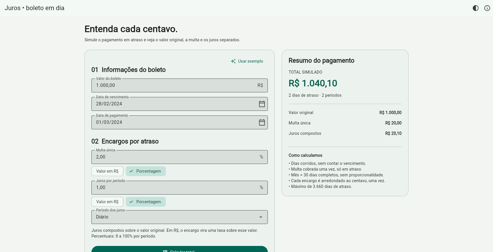

# Interest Calculator

[](https://docs.flutter.dev/)
[](https://dart.dev/)
[](LICENSE)
[](https://github.com/kleberandrade/interest-calculator-flutter/actions/workflows/ci.yml)

A Portuguese classroom app for exploring **compound interest on overdue payment slips**, created by **Kleber de Oliveira Andrade**. Enter the original amount, due/payment dates, one-time fee and interest per day or completed 30-day month. See every charge separately in a responsive, accessible Material interface.



## Requirements and installation

Use **Flutter 3.50.0 stable**, which includes **Dart 3.14.0**, and Chrome for the verified Web workflow. Keep `pubspec.lock` committed. No account, database, Firebase setup, credentials or API keys are required.

```sh
git clone https://github.com/kleberandrade/interest-calculator-flutter.git
cd interest-calculator-flutter
flutter --version
flutter pub get --enforce-lockfile
flutter run -d chrome
```

For Android, install the Flutter-compatible Android SDK and JDK 21. The generated host uses Java 17 bytecode, Kotlin 2.4.20, Android Gradle Plugin 9.3.1 and Gradle 9.5.0. For iOS, use macOS/Xcode and iOS 15 or later. A physical-device distribution build needs your own signing configuration. Android release configuration currently uses the template's debug key for local experiments; configure your own key before distribution. Nothing in this project publishes an app.

## Try it

1. Select **Usar exemplo**. It fills a fictional R$ 1,000.00 slip, due 28 February 2024 and paid 1 March 2024, with a 2% fee and 1% daily compound interest.
2. Select **Calcular total**. The result is **R$ 1.040,10**: original R$ 1.000,00 + fee R$ 20,00 + interest R$ 20,10.
3. Edit a value: the old result disappears, preventing a stale quote. Select **Limpar** to reset fields and dates. The toolbar offers light/dark themes and application credits/licenses.

Input uses Brazilian notation: `1.234,56`, `1234,56`, `2,5` or `0`. A dot is a thousands separator, never a decimal separator. Dates must be real calendar dates in `dd/mm/yyyy`; date pickers are also available. Keyboard navigation, labeled inputs/buttons, error messages and a live result region use native Flutter semantics. The Web screen stacks its panels below 850 logical pixels. Values and theme are held in memory only; reloading resets the app.

## Calculation conventions

This intentionally preserves the lesson's **compound**, rather than simple, interest model. It is an educational simulation, not a claim of banking or legal compliance. Check the actual terms of a payment slip independently.

- `P`: original principal, in integer cents. `d`: positive calendar-day difference, excluding the due date. Calendar components are normalized to UTC to avoid daylight-saving/hour truncation.
- `n = d` for daily interest; `n = floor(d / 30)` for monthly interest. Partial months do not accrue interest. The displayed overdue-day count always remains days.
- `r = percentage / 100`, or `fixed monetary interest / P`. The fixed monetary input becomes a rate on the **original** principal and then compounds; it is not a repeated flat addition.
- `interest = P × ((1 + r)^n − 1)`. The fee is either its fixed monetary amount or `P × feePercentage / 100`. The fee is charged once and does not itself accrue interest.
- Each charge is rounded **once**, to the nearest cent with halves rounded up; `total = P + roundedFee + roundedInterest`. BigInt rational powers keep intermediate calculations exact, with no binary floating point money.
- Payment on/before the due date returns the original value with zero charges. A late zero-principal slip may have a fixed fee, but positive fixed monetary interest requires a positive principal to define its rate.

Boundaries: nonnegative values only; principal/fixed charges up to R$ 10,000,000,000.00; percentages from 0 to 100.00% per period; dates from 1900 through 2100; at most 3,660 overdue days; total up to R$ 10,000,000,000,000.00. These are resource/simulation limits, not legal thresholds. Inputs allow at most two fractional digits and are rejected rather than silently rounded.

Independent examples: R$ 1,000.00 at 1% daily for two days produces `1000 × (1.01² − 1) = 20.10` interest. With 29 late days on the monthly setting, interest is zero but a 2% fee is R$ 20.00. At 60 days there are two periods, yielding R$ 20.10 interest. For a one-cent slip, a 50% fee and one period of 50% interest each round from half a cent to one cent: total R$ 0.03.

## Architecture

- `lib/domain/calculation.dart`: validated immutable `Slip`, typed charge units/periods, pure `calculate` function and immutable result. Values use integer hundredths (cents or hundredths of a percent).
- `lib/domain/input.dart`: strict localized decimal/date parsing and integer-only formatting, separate from calculation.
- `lib/pages/calculator_page.dart`: form lifecycle, date pickers, validation, examples, reset and result presentation. Controllers are disposed.
- `lib/main.dart`: Portuguese localization, theme state and application entry point.
- `test/`: independently calculated fixtures, boundary/date tests and user interaction/layout tests.
- `integration_test/`: the same application running on a native simulator, exercising calculation, invalid input, reset and theme changes.
- `web/`, `android/`, `ios/`: platform hosts. No remote services or persisted financial data.

## Tests and builds

```sh
flutter pub get --enforce-lockfile
dart format --output=none --set-exit-if-changed lib test integration_test tool
flutter analyze
flutter test --coverage
flutter build web --release
python3 -m http.server 8788 --bind 127.0.0.1 --directory build/web
# Open http://127.0.0.1:8788
```

The `Flutter CI` workflow runs those Flutter checks on pushes to `master` and pull requests, and uploads the Web bundle and LCOV coverage. A separate macOS 26 job uses Xcode 26.6, builds an unsigned iOS release, and runs the native calculator integration test on a dedicated iPhone 17 / iOS 26.5 simulator. The simulator is removed after the run. There is no automatic deployment. Flutter's default Web build can retrieve engine/font resources from its configured CDN at runtime, so an initial connection is required; offline installation is not promised.

To repeat the native iOS check on macOS, select an installed simulator from `flutter devices` (or create/boot one in Xcode), then use its exact identifier:

```sh
flutter build ios --simulator --debug
flutter test integration_test/calculator_test.dart -d <simulator-udid>
flutter build ios --release --no-codesign
```

The unsigned release checks device compilation; it is not an installable signed archive or an App Store submission. See [the runner image inventory](https://github.com/actions/runner-images/blob/main/images/macos/macos-26-arm64-Readme.md) for the CI toolchain.

Local verification: 12 tests passed, including a 360px layout with 1.5× text. Both domain files had every executable line covered in the generated LCOV report; this is not a branch-coverage or mutation-score claim. Analyzer and release Web build passed. Chrome interaction checks covered the example, invalid negative amount, stale-result clearing, reset, theme switching, and a real 390px viewport. The additional native integration scenario passed on an iPhone 17 / iOS 27.2 simulator with Xcode 27.2; simulator debug and unsigned device release builds also passed. Screenshots remain actual browser captures; no physical phone test is claimed. See [validation notes](docs/validation.md) for mobile build results and tooling limits.

## Migration from the 2020 lesson

Dart 2 mutable `PaymentSlip`/`ResultPaymentSlip` and the UI-coupled `Controller` have been replaced by the pure domain above. These were internal classroom classes, not a published API. The percentage/reais and day/month options remain. The unfinished clear/theme/about actions now work. Portrait locking is removed for responsive Web and landscape layouts. The old packages `flutter_masked_text`, `datetime_picker_formfield` and `custom_radio_grouped_button` are removed; Flutter's own fields, date picker, chips and dropdown replace them. `intl` 0.20.3 remains an SDK localization transitive dependency, not a financial parser. `cupertino_icons` 2.0.0 supplies the native icon font used by SDK widgets. `flutter_lints` 6.0.0 is the current stable lint package. Material components and localization now come from the official `material_ui` 1.11.1 package (with transitive `cupertino_ui` 1.1.7), following Flutter 3.50’s design-library migration. See [the complete dependency audit](docs/dependencies.md) for every resolved version and the two explicit SDK-pin patch overrides.

Android uses the declarative Kotlin Gradle configuration and Flutter v2 embedding. iOS uses the current scene-based template with the original bundle identifier and an iOS 15 minimum. No stored user data requires migration. Exact rounding and calendar days can differ from the old double/time-of-day calculation; these intentional corrections are tested and documented above.

## Teaching material and credits

Read the [original Portuguese Medium tutorial](https://medium.com/flutter-comunidade-br/desenvolvimento-de-uma-calculadora-de-juros-para-boletos-vencidos-44ab70fcf0cd), the [preserved 2020 classroom notes and screenshots](docs/original-lesson.md), the [current demo guide](docs/demo.md), and the [modernization log](docs/work-log.md). Historical dependency snippets are not the installation instructions for this version.

MIT © 2020 Kleber de Oliveira Andrade. The original README's MIT grant is preserved in [LICENSE](LICENSE). Flutter/Dart and bundled components retain their own notices; **Sobre o aplicativo → Acessar licenças** displays Flutter's license registry. No third-party tutorial or image is relicensed by this repository.
