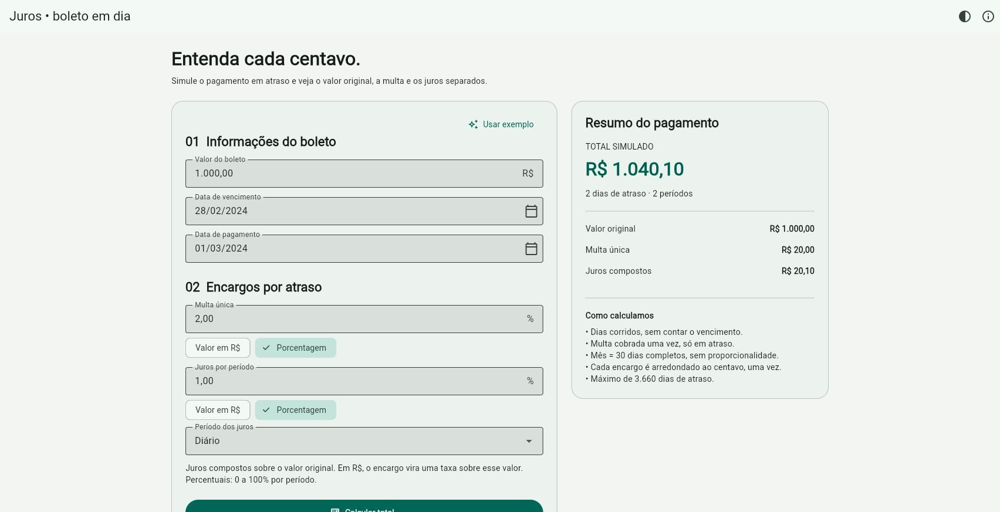

# Desenvolvimento de uma Calculadora de Juros para Boletos vencidos

## Notas de aula do professor Kleber de Oliveira Andrade


Um boleto de R$ 1.000,00 venceu em 28/02/2024 e será pago em 01/03/2024. Com multa de 2% e juros compostos de 1% ao dia, quanto devemos simular? Nesta aula vamos chegar a R$ 1.040,10, conferir cada parcela e entender por que datas, centavos e arredondamento fazem parte do domínio do problema.

A proposta é construir uma calculadora educativa em Flutter, separando entrada de dados, regras de cálculo e interface. Ao terminar, você saberá validar números brasileiros, trabalhar com dinheiro sem double, testar uma função pura e apresentar um resultado acessível em telas largas e estreitas. Esta revisão usa Flutter 3.50.0 e Dart 3.14.0, verificados em 17/11/2026.

## 1. Prepare o ambiente e confira as versões

Use a versão estável Flutter 3.50.0, que inclui Dart 3.14.0, e o Chrome. Confira o arquivo de versões do SDK oficial antes de instalar: https://docs.flutter.dev/install/archive. Em seguida, obtenha o projeto:

```sh
git clone https://github.com/kleberandrade/interest-calculator-flutter.git
cd interest-calculator-flutter
flutter --version
flutter pub get --enforce-lockfile
flutter run -d chrome
```

O projeto não precisa de Firebase, banco de dados, cadastro ou chave de API. Os dados são fictícios e ficam somente na memória do aplicativo. Recarregar a página reinicia o estado.

As dependências diretas atuais são flutter e flutter_localizations do SDK 3.50.0, cupertino_icons 2.0.0, material_ui 1.11.1, flutter_test e integration_test do mesmo SDK e flutter_lints 6.0.0. Os ícones Cupertino atendem aos componentes nativos; as traduções de calendários e diálogos vêm da localização do Flutter. flutter_test verifica domínio e widgets; integration_test executa os fluxos no simulador com o aplicativo nativo.

```yaml
environment:
  sdk: '>=3.14.0 <4.0.0'
  flutter: '>=3.50.0'

dependencies:
  cupertino_icons: ^2.0.0
  material_ui: ^1.11.1
  flutter:
    sdk: flutter
  flutter_localizations:
    sdk: flutter

dev_dependencies:
  flutter_test:
    sdk: flutter
  integration_test:
    sdk: flutter
  flutter_lints: ^6.0.0

dependency_overrides:
  material_color_utilities: 0.13.1
  test_api: 0.7.15
```

Todas as dependências diretas estão nas versões estáveis atuais resolvidas para esta configuração. A atualização também elevou dependências indiretas, incluindo cupertino_ui 1.1.7, intl 0.20.3, clock 1.1.3, matcher 0.12.20, meta 1.19.0, stack_trace 1.12.2 e vector_math 2.4.4. intl é usado pela localização do SDK; não é o nosso leitor de dinheiro.

O SDK Flutter 3.50.0 ainda fixa material_color_utilities em 0.13.0 e test_api em 0.7.14. Nesta revisão, usamos as versões estáveis mais recentes desses dois pacotes, 0.13.1 e 0.7.15, por meio de duas substituições locais explícitas. Esses patches passaram pela análise, pelos testes e pelo build Web desta aplicação. Isso não equivale a certificar qualquer aplicativo ou toda a suíte do SDK. Quando o Flutter incorporar as mesmas versões, remova as substituições e repita as verificações. O pubspec.lock e a auditoria completa no repositório registram o resultado exato.

Os antigos flutter_masked_text, datetime_picker_formfield e custom_radio_grouped_button foram substituídos por componentes do próprio Flutter. No Android, o host usa Kotlin 2.4.20, AGP 9.3.1 e Gradle 9.5.0, com Java 17 como alvo. A configuração é declarativa: não volte ao Gradle 5.6 da aula de 2020. O host iOS usa cenas e requer iOS 15 ou posterior. Assinaturas para distribuição precisam ser configuradas pelo responsável pelo aplicativo.

## 2. Observe o resultado antes de programar



Selecione Usar exemplo e depois Calcular total. O formulário já contém o boleto do início da aula: R$ 1.000,00, vencimento em 28/02/2024, pagamento em 01/03/2024, multa de 2% e juros diários de 1%. O resumo deve separar R$ 1.000,00 de principal, R$ 20,00 de multa e R$ 20,10 de juros. A soma é R$ 1.040,10.

Agora altere uma entrada. O resumo anterior desaparece para que um resultado antigo não pareça corresponder aos dados novos. Limpar reinicia valores e datas; a barra superior permite alternar entre tema claro/escuro e consultar informações e licenças. São comportamentos úteis para testar, além de observar a aparência da tela.

## 3. Defina a convenção financeira com precisão

A calculadora preserva os juros compostos da proposta original. Não existe uma regra universal de boleto implementada aqui: a simulação não consulta bancos e não declara conformidade bancária ou jurídica. Confira as condições do documento real separadamente.

Chamaremos de P o valor original, de r a taxa por período e de n a quantidade de períodos. A fórmula é: juros = P multiplicado por ((1 + r) elevado a n, menos 1). A multa não entra na base dos juros; ela é adicionada uma única vez quando existe atraso.

No exemplo, a razão da taxa é 1/100 e existem dois dias corridos de atraso. Primeiro, 1000 multiplicado por 1,01 resulta em 1010. No segundo período, 1010 multiplicado por 1,01 resulta em 1020,10. Portanto, os juros são 20,10. A multa única é 1000 multiplicado por 2/100, ou 20,00. Somamos principal, multa e juros: 1000 + 20 + 20,10 = 1040,10.

No modo mensal, um mês significa 30 dias completos: n é a divisão inteira dos dias por 30. Assim, 29 dias de atraso geram zero períodos mensais; 60 dias geram dois. Não há proporcionalidade de mês incompleto. A multa continua sendo cobrada uma vez a partir do primeiro dia de atraso. Pagamento antecipado ou no vencimento devolve somente o principal.

Também é possível informar juros em reais. Nesse caso, o encargo é convertido em uma taxa sobre o principal original e depois capitalizado. Informar R$ 10,00 para um principal de R$ 1.000,00 equivale à taxa de 1% por período; isso não significa somar dez reais fixos todos os dias. Um principal igual a zero não permite definir uma taxa positiva em reais.

Cada encargo é arredondado uma única vez, ao centavo mais próximo, com meio centavo para cima. Um boleto de um centavo com multa de 50% e um período de juros de 50% produz um centavo de multa e um centavo de juros: total de três centavos. Arredondar somente o total definiria outra regra.

## 4. Separe texto localizado de valores do domínio

Na fronteira com o formulário, lib/domain/input.dart lê textos brasileiros. O texto 1.234,56 representa 123456 centavos. Já 2,00, quando o campo representa uma porcentagem, corresponde a 200 centésimos de porcentagem. A unidade é definida por ChargeUnit; o texto isolado não conhece seu significado financeiro.

```dart
import 'package:interest_calculator/domain/input.dart';

void main() {
  final cents = parseDecimal('1.234,56');
  print(cents); // 123456
  print(formatMoney(cents)); // R$ 1.234,56
  print(parseDecimal('2,00')); // 200
}
```

Um ponto é separador de milhar, nunca separador decimal. Valores negativos, notação exponencial, textos vazios e mais de duas casas decimais são rejeitados. Não usamos double.parse seguido de multiplicação por 100: isso introduziria ponto flutuante binário na representação do dinheiro.

As datas são validadas antes de entrar no cálculo. 29/02/2024 é uma data válida; 29/02/2023 e 31/04/2024 não são. O domínio considera os componentes de calendário em UTC, ignorando a hora do relógio, para evitar que horário de verão ou horários distintos reduzam indevidamente a contagem de dias.

## 5. Execute o domínio sem abrir a interface

lib/domain/calculation.dart contém Slip imutável, os enums ChargeUnit e Period e a função pura calculate. A entrada é validada uma vez; o cálculo não precisa de BuildContext, controladores de texto nem acesso à rede. A representação intermediária usa frações exatas com BigInt, inclusive na potência dos juros compostos.

O exemplo abaixo está disponível em tool/lesson_example.dart. Ele usa as mesmas fronteiras do formulário, mas funciona pela linha de comando:

```dart
import 'dart:io';

import 'package:interest_calculator/domain/calculation.dart';
import 'package:interest_calculator/domain/input.dart';

void main() {
  final slip = Slip(
    principal: parseDecimal('1.000,00'),
    fee: parseDecimal('2,00'),
    interest: parseDecimal('1,00'),
    feeUnit: ChargeUnit.percent,
    interestUnit: ChargeUnit.percent,
    period: Period.day,
    due: parseDate('28/02/2024'),
    paid: parseDate('01/03/2024'),
  );
  final result = calculate(slip);
  stdout.writeln('Original: ${formatMoney(result.principal)}');
  stdout.writeln('Multa: ${formatMoney(result.fee)}');
  stdout.writeln('Juros: ${formatMoney(result.interest)}');
  stdout.writeln('Total: ${formatMoney(result.total)}');
}
```

```sh
dart run tool/lesson_example.dart
```

A saída esperada é Original: R$ 1.000,00; Multa: R$ 20,00; Juros: R$ 20,10; Total: R$ 1.040,10. Compare a saída com o cálculo manual da seção anterior antes de confiar na implementação.

Os limites são explícitos: entradas monetárias não negativas até R$ 10 bilhões, percentuais de 0 a 100,00% por período, datas de 1900 a 2100, até 3.660 dias de atraso e total máximo de R$ 10 trilhões. São limites computacionais e educativos. Pagamento antecipado resulta em zero dias de atraso; não é convertido em juros negativos.

## 6. Construa uma apresentação acessível

A tela de lib/pages/calculator_page.dart concentra os TextEditingController, seus descartes, a validação dos campos e as ações. lib/main.dart configura localização e temas. Os antigos PaymentSlip, ResultPaymentSlip, Controller e Constantes pertencem ao histórico de 2020; não são a API atual.

No Flutter 3.50, os componentes Material foram desacoplados do SDK. Por isso, lib/main.dart, a tela e os testes importam package:material_ui/material_ui.dart, em vez do antigo package:flutter/material.dart. GlobalMaterialLocalizations.delegates também vem de material_ui; ele inclui os delegados necessários à localização. A migração segue a orientação oficial em https://docs.flutter.dev/release/breaking-changes/material-ui-and-cupertino-ui.

TextFormField mantém rótulos visíveis e apresenta erros junto ao campo. showDatePicker oferece uma alternativa ao teclado. ChoiceChip distingue reais de porcentagem, e DropdownButtonFormField define o período. O resumo usa uma região semântica que anuncia alterações. Botões nativos mantêm estados de foco e interação; ícones têm descrições.


Abaixo de 850 pixels lógicos, o resumo aparece depois do formulário, em vez de ficar comprimido ao lado dele. A captura acima é do Chrome em uma janela de 390 por 844 pixels, não de um telefone físico. Há também um teste de layout com 360 pixels e texto ampliado em 50%. Não use somente cores para explicar qual campo está inválido ou qual valor representa o total.

## 7. Prove o comportamento antes de mudar a fórmula

O projeto já verifica o exemplo independente, encargos fixos e percentuais, zero, negativos, limites, mês incompleto, datas invertidas, ano bissexto e arredondamento de meio centavo. Os testes de interface exercitam exemplo, cálculo, remoção de resultado antigo, erro, limpeza, tema e layout estreito.

Este é o núcleo do primeiro exemplo de comportamento, apresentado aqui com importação e função de teste completos:

```dart
import 'package:flutter_test/flutter_test.dart';
import 'package:interest_calculator/domain/calculation.dart';

void main() {
  test('two daily compound periods plus a one-time fee', () {
    final result = calculate(Slip(
      principal: 100000,
      fee: 200,
      interest: 100,
      feeUnit: ChargeUnit.percent,
      interestUnit: ChargeUnit.percent,
      period: Period.day,
      due: DateTime.utc(2024, 2, 28),
      paid: DateTime.utc(2024, 3, 1),
    ));
    expect(result.days, 2);
    expect(result.fee, 2000);
    expect(result.interest, 2010);
    expect(result.total, 104010);
  });
}
```

Salve um teste semelhante em test/ e execute a verificação completa:

```sh
flutter pub get --enforce-lockfile
dart format --output=none --set-exit-if-changed lib test integration_test tool
flutter analyze
flutter test --coverage
flutter build web --release
flutter pub outdated
```

A execução de teste não substitui a conferência de um cálculo independente. Cobertura de linhas mostra o que foi executado, não prova que todas as regras foram verificadas. As versões usadas no CI estão registradas no repositório, e a pasta build/web é o resultado do build Web; isso não publica automaticamente um site. No macOS, confira o identificador do simulador em flutter devices e execute flutter test integration_test/calculator_test.dart -d <simulator-udid>. Essa verificação passou no iPhone 17 simulado com iOS 27.2 e Xcode 27.2, confirmando cálculo, erro, remoção de resultado antigo, limpeza e tema. A compilação iOS de release sem assinatura também passou; ela verifica o alvo de dispositivo, sem produzir uma distribuição assinada. O README contém o comando completo dessa compilação.

## Código completo, créditos e histórico

O código atual, as versões resolvidas, a auditoria de dependências e os limites verificados estão em https://github.com/kleberandrade/interest-calculator-flutter. Consulte também a documentação em docs/ e o guia específico de demonstração. A licença MIT preserva a autoria de Kleber de Oliveira Andrade; dependências mantêm suas próprias licenças, acessíveis no aplicativo.

Esta aula nasceu em 2020 na disciplina de Programação Mobile. O material histórico, os links úteis e as imagens antigas estão preservados em docs/original-lesson.md no mesmo repositório. Como referência da apresentação original, permanece o vídeo da Carol sobre juros e multas: https://www.youtube.com/watch?v=ln5quWCXmOk. Os comandos e códigos para executar a revisão atual são os desta versão do artigo.

A capa é uma ilustração editorial criada com auxílio de IA para esta revisão; as imagens da interface são capturas reais do aplicativo Web. Não representam teste físico em Android ou iPhone. O README registra separadamente os resultados por plataforma: o build de simulador, o teste de integração no iOS 27.2 e o build iOS de release sem assinatura passaram. Distribuição assinada e teste em aparelho físico continuam fora dessa verificação.

## Cinco exercícios para praticar

1. Valide entradas e datas. Escreva testes para rejeitar valor negativo, percentual acima de 100,00%, 29/02/2023 e 31/04/2024. Inclua um caso válido em 29/02/2024 e explique por que DateTime, sozinho, pode normalizar uma data que o formulário deveria rejeitar.

2. Compare juros simples e compostos. Acrescente uma opção explícita de juros simples, mantendo o modo composto existente. Para R$ 1.000,00, taxa de 1% e dois períodos, comprove juros de R$ 20,00 no modo simples e R$ 20,10 no composto; inclua a multa somente depois de calcular os juros.

3. Investigue o mês incompleto. Crie testes com 29, 30, 59 e 60 dias no modo mensal atual. Depois implemente, como alternativa claramente nomeada, uma convenção proporcional. Documente a diferença e evite trocar silenciosamente a regra de 30 dias completos.

4. Demonstre o arredondamento. Use um boleto de um centavo com multa de 50% e um período de juros de 50%. Verifique o total de três centavos na regra atual e escreva um exemplo que mostre como arredondar somente o total produziria outro resultado. Continue usando representação exata.

5. Melhore a experiência e prove que funciona. Acrescente uma ação acessível para copiar o detalhamento do resultado. Teste o texto copiado, a ausência de resultado desatualizado após edição e o uso com teclado. Confira 360 pixels de largura, texto ampliado e os temas claro e escuro; inclua uma captura real e descreva quais verificações você realizou.
